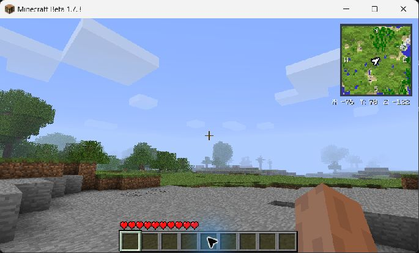
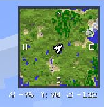

# BetaPlus

BetaPlus is a planned client-side quality-of-life mod for Minecraft Java Edition Beta 1.7.3. Its first release is intended to include a minimap, waypoints, coordinates, death markers, and configurable controls.

**Version 1.0.0:** a client-side surface minimap and coordinate HUD for Minecraft Java Edition Beta 1.7.3. Waypoints and death markers are planned, not included. The release ZIP has been loaded in an isolated obfuscated Beta client with the ModLoader fix; launcher-specific installation and multiplayer compatibility have not been verified.

## Minimap and controls

The map displays sampled terrain using Beta's map colors and simple height shading, a pixel-style player arrow, and cardinal directions. The coordinate readout uses Minecraft's font beneath the map (or above it when the map is at the bottom of the screen). Both hide while a screen or the F3 debug display is open, or the HUD is hidden. The map uses a 64-by-64 sample grid; sampling is limited to 96 columns per world tick and only queries loaded chunks. A world-coordinate cache reuses samples as the player moves and clears on a world change. Newly revealed areas can take a little time to fill in.

Default controls are **M** to toggle the map, **=** to zoom in, **-** to zoom out, and **C** to toggle coordinates. These are registered with ModLoader and can also appear in the game's control settings. Automated key testing has not yet confirmed their behavior.

Settings are created in the instance's `config/BetaPlus.properties`. Edit them with the game closed: `enabled` and `coordinates` are true or false; `size` is 40–160 GUI pixels; `zoom` is 1, 2, or 4 blocks per sample; `position` is `top-right`, `top-left`, `bottom-right`, or `bottom-left`; `opacity` is 0.2–1.0; `key` is an LWJGL 2 numeric key code (default 50, M). Changes to the file take effect on restart. Toggle and zoom changes are saved automatically.

The default map size is 70 pixels. On upgrading, previous default sizes of 50, 80, or 96 pixels are changed once to the new default; other sizes are retained. You can set it back after that migration.

## Installation

Use a separate Beta 1.7.3 instance and back up your worlds. Each player needs Minecraft Java Edition and a launcher that supports historical versions.

1. In [Prism Launcher](https://prismlauncher.org/), sign in with your Minecraft account and create an instance for **Beta 1.7.3** (enable Beta versions in the version picker). Select a Java 8 runtime for the instance.
2. Download [ModLoader Fix b1.7.3 1.0.0](https://github.com/coffeenotfound/ModloaderFix-b1.7.3/releases/tag/v1.0.0). In the instance's **Edit → Version**, use **Add to Minecraft.jar** to add the ModLoader fix JAR. It is the complete loader; do not install a second copy of ModLoader.
3. Download `BetaPlus-1.0.0.zip` from the [BetaPlus releases](https://github.com/asmirrr/BetaPlus/releases). Open the instance's Minecraft folder and put the ZIP, without extracting it, in its `mods` folder (create that folder if needed).
4. Launch the instance and enter a world. Press M to toggle the map; F3 hides it while debug information is shown.

The ZIP is a ModLoader mod, not a Fabric or Forge mod. The above Prism workflow has not been personally tested; the ZIP was tested in a separate obfuscated Beta client with the same ModLoader fix and Java 8. If the game fails to start, check the instance log and confirm the version and loader before adding other mods.

To package a build after recompiling and reobfuscating in the local workspace, run `./scripts/package-release.ps1` from PowerShell. It writes `build/BetaPlus-1.0.0.zip` and reports its SHA-256; move an existing ZIP aside before rebuilding.

## Development approach

The target is the original Beta 1.7.3 client using Risugami ModLoader and MCP-style mappings. The local smoke test used [RetroMCP-Java v1.2](https://github.com/MCPHackers/RetroMCP-Java/releases/tag/v1.2), an MCP rewrite supporting Beta 1.7.3, and the [Beta 1.7.3 ModLoader fix](https://github.com/coffeenotfound/ModloaderFix-b1.7.3). This is not MCP 4.3 itself. The game uses LWJGL 2 and legacy OpenGL; modern Minecraft APIs and modern Forge are not compatible. ModLoader and other jar mods can conflict if they modify the same game classes. Multiplayer support must be tested separately; the client can only display information the server sends it.

Java 8 is a practical starting point for running this legacy client. The original MCP scripts and compiler have their own historical requirements; confirm a compatible JDK and Python runtime with the particular MCP distribution before relying on a build. Do not distribute Minecraft's game jar, decompiled sources, ModLoader, or other third-party binaries in this repository.

## Environment setup

1. Obtain a legitimate Minecraft Java Edition installation and install or launch Beta 1.7.3 through a launcher that supports historical versions. Use a separate instance for testing.
2. Obtain MCP 4.3 and the matching Beta 1.7.3 ModLoader from trustworthy sources. Follow their licensing and distribution terms.
3. Set up MCP with the Beta client jar, matching LWJGL 2 libraries and platform natives. Install ModLoader into the development client before decompiling, following the instructions for that MCP distribution. Keep this environment outside the repository.
4. Verify the unmodified ModLoader development client launches before adding BetaPlus. MCP's recompile and reobfuscate steps produce the classes needed for a jar mod. The precise commands depend on the MCP distribution and platform.

Reference: [Beta 1.7.3 MCP setup](https://emberden.github.io/mcp.html) and [MCP 4.3 setup notes](https://gist.github.com/Benetekt/cec4bac99dd105a025111349c1b2a787). These are historical community instructions, not a verified BetaPlus build recipe.

### Current local smoke-test workspace

The ignored `mcp/` directory contains RetroMCP, an isolated Java 8 JDK, and a copy of the Beta client with the ModLoader fix applied. From PowerShell in that directory, copy all `../src/net/minecraft/src/*.java` into `minecraft/src/net/minecraft/src/`, then run:

```powershell
& .\jdk\jdk8u504-b01\bin\java.exe -jar .\downloads\RetroMCP-Java-CLI.jar recompile
& .\jdk\jdk8u504-b01\bin\java.exe -jar .\downloads\RetroMCP-Java-CLI.jar reobfuscate
```

For the development launch, copy `mod_BetaPlus.class` and both `BetaPlus*.class` files from `minecraft/bin/net/minecraft/src/` to `minecraft/game/mods/BetaPlus/net/minecraft/src/` and run `& .\jdk\jdk8u504-b01\bin\java.exe -jar .\downloads\RetroMCP-Java-CLI.jar start client`. The mods-folder copy is needed because ModLoader's development directory scan does not discover the class automatically. This local workspace is not a reproducible setup script or an installation package yet.

## Planned design

Terrain sampling will be bounded and cached, with unloaded chunks left unknown. Waypoints and settings will be stored locally, with separate world/server and dimension identities where these can be reliably determined. Death detection, world transitions, multiplayer identity, and OpenGL state restoration require validation against the actual Beta client before implementation claims can be made.

## Screenshots

BetaPlus in a Beta 1.7.3 test world:



Minimap and coordinates detail (cropped from the same screenshot):



## Known issues

- The release ZIP was tested in an isolated obfuscated client, but the Prism Launcher installation steps have not been tested.
- Zoom and toggle controls, movement, turning, and performance still need thorough playtesting. Fast movement can leave temporary gaps while the cache catches up.
- The surface sampler is approximate: tall foliage, transparent blocks, caves and the Nether may not be represented accurately. Unloaded chunks remain blank.
- There is no configuration menu; edit the properties file while the game is closed.
- Compatibility with other mods and multiplayer is untested.
